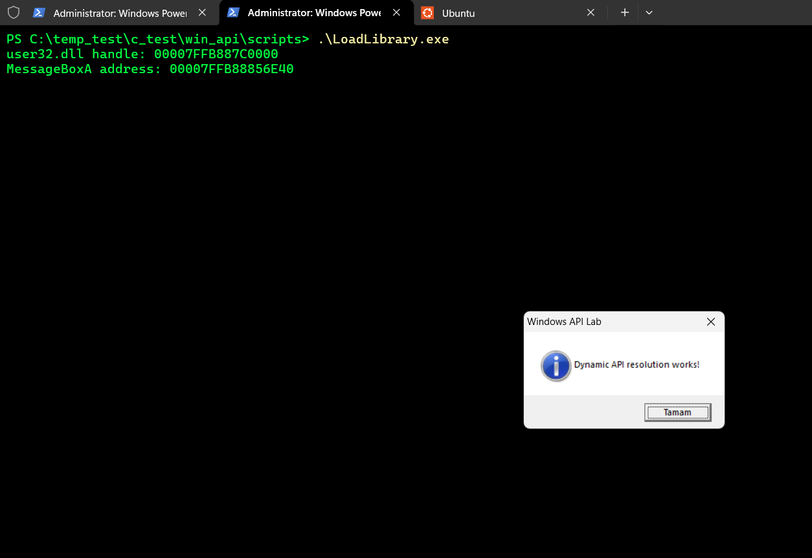
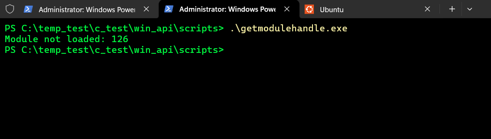
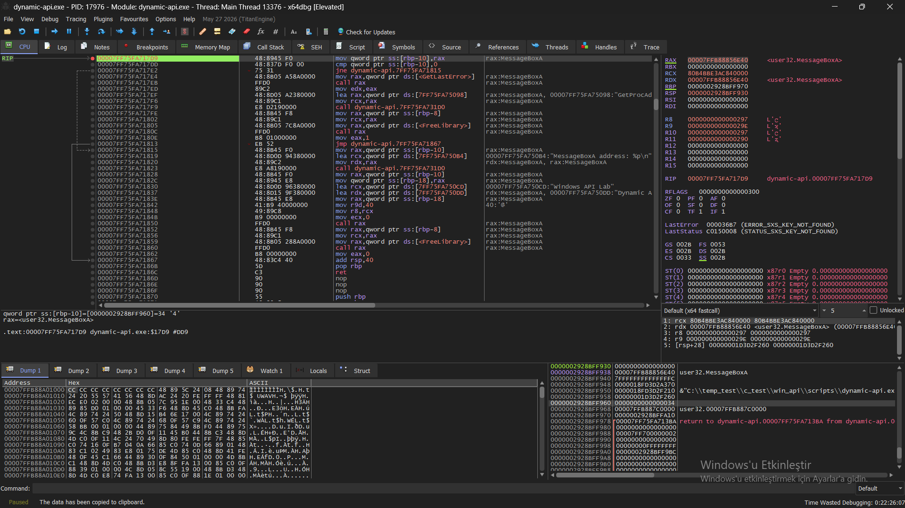
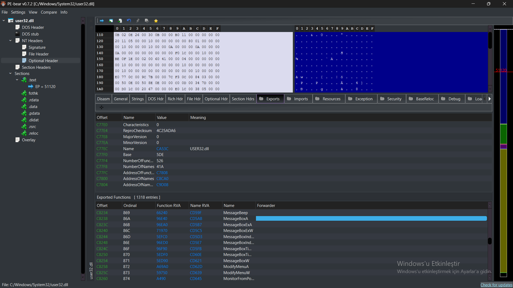

# Dynamic API Resolution: LoadLibraryA, GetModuleHandleA, and GetProcAddress

## 1. Objective

The goal of this study is to understand how Windows API functions are resolved dynamically at runtime and to verify this process using C code, x64dbg, and PE-bear.

The following topics are covered:

- Loading a DLL into a process with `LoadLibraryA()`.
- Getting the handle of a module already loaded in memory with `GetModuleHandleA()`.
- Finding the address of a function inside a DLL with `GetProcAddress()`.
- Inspecting API call parameters and return values in x64dbg.
- Verifying a function RVA in the export table using PE-bear.

## 2. Loading a DLL with LoadLibraryA

In the first step, `LoadLibraryA("user32.dll")` was called to load the `user32.dll` module, and the returned handle was inspected.

When successful, `LoadLibraryA()` returns a handle to the loaded module. This handle can be used in subsequent API resolution operations.

**Expected result:** The function returns a non-NULL handle.

[LoadLibraryA](../../scripts/LoadLibrary.c)

> A screenshot of the terminal/output showing the program's `LoadLibraryA()` call and successful return value will be added here.

## 3. Checking a Module with GetModuleHandleA

In the second step, the call to `GetModuleHandleA("user32.dll")` was examined.

In the first attempt, made while the DLL was not yet loaded in the process, the function returned NULL and `GetLastError()` was observed to return `126`. This error means `ERROR_MOD_NOT_FOUND`.

After calling `LoadLibraryA()`, `GetModuleHandleA()` was called again. The handles returned by the two functions were observed to be identical:

- `LoadLibraryA()` → `00007FFB887C0000`
- `GetModuleHandleA()` → `00007FFB887C0000`

This confirms that both calls return a handle representing the base address of the same loaded module.

**Important difference:** `LoadLibraryA()` increments the module's reference count. `GetModuleHandleA()` retrieves the existing handle without incrementing the reference count. Therefore, a handle obtained only through `GetModuleHandleA()` should not be released with an independent `FreeLibrary()` call.

[GetModuleHandleA](../../scripts/getmodulehandle.c)

## 4. Resolving the Address of MessageBoxA with GetProcAddress

In the next step, `GetProcAddress()` was used to obtain the address of the `MessageBoxA` function inside `user32.dll`.

The steps are as follows:

1. `user32.dll` was loaded with `LoadLibraryA()`.
2. The resulting module handle was passed to `GetProcAddress()`.
3. The function name, `"MessageBoxA"`, was passed as the second argument.
4. The returned function pointer was cast to a compatible function pointer type and called.

This method finds the address of `MessageBoxA` at runtime instead of calling it directly through a static reference.

[Dynamic API](../../scripts/dynamicApi.c)

## 5. Inspecting the API Call with x64dbg

The `GetProcAddress()` call was inspected in x64dbg. Under the Windows x64 calling convention, the first two parameters are passed in the `RCX` and `RDX` registers, respectively.

The following values were observed at the function entry:

| Register / field | Observed value | Description |
|---|---|---|
| `RCX` | `00007FFB887C0000` | Handle to the `user32.dll` module |
| `RDX` | `00007FF75FA7508C` | Address of the `"MessageBoxA"` string |
| Stack | `00007FF75FA717D9` | Return address after the call |

At the return from `GetProcAddress()`, the `RAX` register was inspected:

- `RAX = 00007FFB88856E40`
- Resolved address: `user32.MessageBoxA`

Under the Windows x64 ABI, integer and pointer return values are passed through `RAX`, which made it possible to verify this result.

## 6. Verifying the Export Table with PE-bear

To verify that the function address obtained in x64dbg was correct, `C:\Windows\System32\user32.dll` was opened in PE-bear and its export table was inspected.

The following information was observed for the `MessageBoxA` entry:

| Field | Value |
|---|---|
| DLL | `user32.dll` |
| Function | `MessageBoxA` |
| Function RVA | `0x96E40` |
| Name RVA | `0xCD5AB` |
| Ordinal | `0x86A` |

The `Function RVA` is the function's relative address from the DLL's base address. The `Name RVA` points to the string containing the function name; it is not the same as the function's executable code address.

## 7. Calculating the VA and RVA

The function's virtual address (VA) observed in x64dbg was compared with the Function RVA shown in PE-bear.

The formula used was:

`VA = ImageBase + RVA`

For this study:

- ImageBase: `0x00007FFB887C0000`
- Function RVA: `0x96E40`

Calculation:

`0x00007FFB887C0000 + 0x96E40 = 0x00007FFB88856E40`

The calculated address matched the value `00007FFB88856E40` observed in the `RAX` register when `GetProcAddress()` returned in x64dbg.

Thus, the function address obtained at runtime was independently verified using the RVA information in the PE file's export table.

## 8. Conclusion

This study experimentally verified the basic steps of dynamic API resolution in Windows.

- A DLL was loaded with `LoadLibraryA()`.
- It was observed that `GetModuleHandleA()` finds only modules that are already loaded and does not increment the reference count.
- The runtime address of `MessageBoxA` was obtained with `GetProcAddress()`.
- API parameters and the return value were inspected in x64dbg.
- The function's virtual address was calculated using the `Function RVA` in the PE-bear export table and matched against the debugger output.

**Key takeaway:** Dynamic API resolution does not end with loading a DLL. The requested function's address is found through the DLL's export information. Understanding this process provides an important foundation for examining API resolution behavior in Windows internals, reverse engineering, and malware analysis.

## 9. Next Step

In the next study, the logic behind what `GetProcAddress()` does will be examined at a lower level. The `AddressOfNames`, `AddressOfNameOrdinals`, and `AddressOfFunctions` fields in the PE export structure will be studied to investigate how a function's address can be found in the export table.
