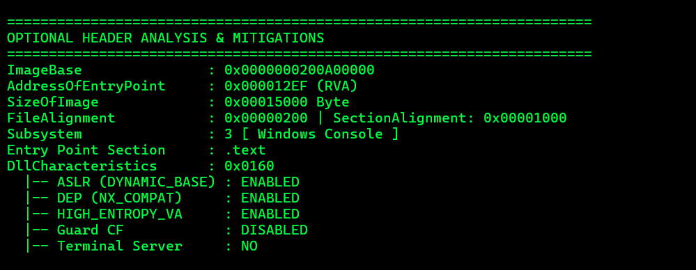
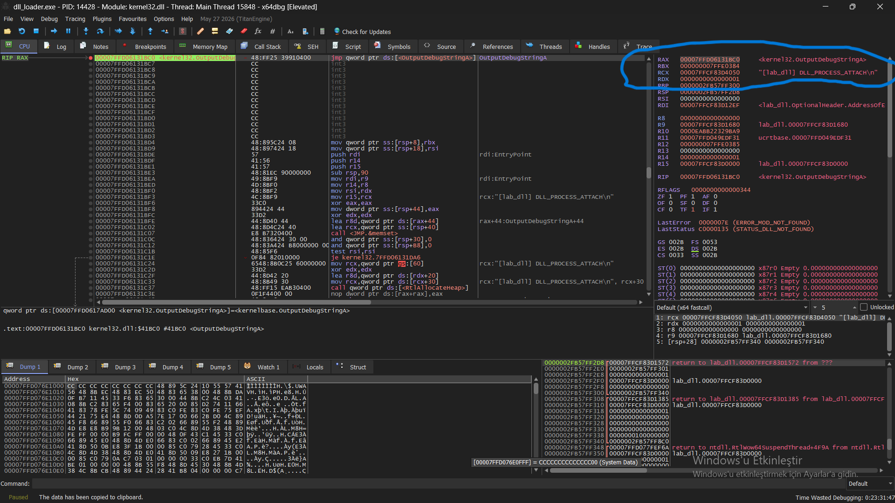
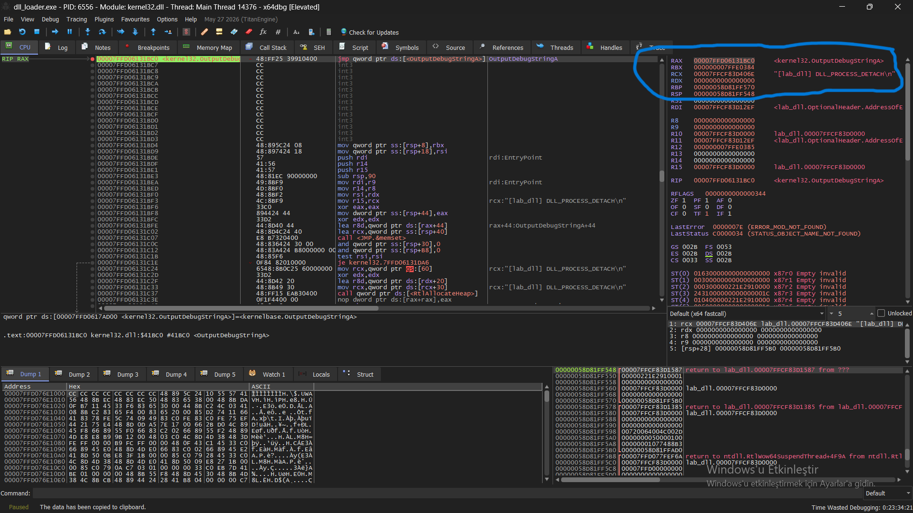

# Windows DLL Lifecycle Analysis: DllMain, Process Attach and Detach

## 1. Objective

The objective of this lab was to understand the Windows DLL lifecycle by implementing a simple DLL, loading it into a test process, and observing its initialization and unloading behavior using x64dbg.

The lab focused on:

- Implementing `DllMain` and handling `DLL_PROCESS_ATTACH` and `DLL_PROCESS_DETACH`.
- Loading and unloading a DLL using `LoadLibraryA()` and `FreeLibrary()`.
- Inspecting PE metadata, including the image base and entry-point RVA.
- Observing DLL lifecycle messages and runtime state in a debugger.
- Understanding the relationship between a PE entry point, the C runtime startup code, and the user-defined `DllMain`.

## 2. Lab Environment

- **Language:** C
- **Compiler:** MinGW GCC
- **Debugger:** x64dbg
- **Custom analysis tool:** `pe-info-parser`
- **Test DLL:** `lab_dll.dll`
- **Loader executable:** `dll_loader.exe`

## 3. DLL Implementation

The DLL defines a `DllMain` callback that emits a debug message when the DLL is attached to or detached from a process.

### `lab_dll.c` 

[lab_dll.c source code](../../scripts/lab_dll.c)

```c
#include <windows.h>

BOOL WINAPI DllMain(
    HINSTANCE hinstDLL,
    DWORD fdwReason,
    LPVOID lpvReserved
)
{
    switch (fdwReason)
    {
        case DLL_PROCESS_ATTACH:
            OutputDebugStringA(
                "[lab_dll] DLL_PROCESS_ATTACH\n"
            );
            break;

        case DLL_PROCESS_DETACH:
            OutputDebugStringA(
                "[lab_dll] DLL_PROCESS_DETACH\n"
            );
            break;
    }

    return TRUE;
}
```

The `fdwReason` parameter identifies the reason Windows is invoking the callback. In this lab, the two relevant values were:

- `DLL_PROCESS_ATTACH` (`1`): the DLL is being loaded into a process.
- `DLL_PROCESS_DETACH` (`0`): the DLL is being unloaded from a process, or the process is terminating.

`OutputDebugStringA()` was used to make these events observable in the debugger.

## 4. Loader Implementation

The loader dynamically loads the DLL, prints its module handle, waits for user input, and then unloads it.

### `dll_loader.c`

[dll_loader.c source code](../../scripts/dll_loader.c)

```c
#include <windows.h>
#include <stdio.h>

int main(void)
{
    HMODULE hDll = LoadLibraryA("lab_dll.dll");

    if (hDll == NULL)
    {
        printf("LoadLibraryA failed: %lu\n", GetLastError());
        return 1;
    }

    printf("DLL loaded. Base address: %p\n", (void *)hDll);
    getchar();

    FreeLibrary(hDll);
    printf("DLL unloaded.\n");

    return 0;
}
```

`LoadLibraryA()` requests that Windows load the DLL and returns its module handle on success. `FreeLibrary()` releases the loader's reference to the module. When the reference count reaches zero and the module is unloaded, the process-detach callback can execute.

### Compilation

```bash
gcc -shared -o lab_dll.dll lab_dll.c
gcc -o dll_loader.exe dll_loader.c
```

The DLL and loader were compiled as separate binaries.

## 5. Static PE Analysis

The custom `pe-info-parser` was used to inspect the DLL's PE metadata before examining its runtime behavior.

Relevant findings included:

- **Architecture:** AMD64 / x64
- **Preferred ImageBase:** `0x0000000200A00000`
- **AddressOfEntryPoint RVA:** `0x12EF`
- **SizeOfImage:** `0x15000`
- **Entry-point section:** `.text`
- **ASLR:** Enabled
- **DEP:** Enabled




### Why the RVA mattered

The PE header's `AddressOfEntryPoint` is an RVA, not a complete virtual address. An RVA is an offset relative to the image base.

The runtime address can be calculated as:

`Runtime Entry Point VA = Runtime Image Base VA + EntryPoint RVA`

For the observed runtime mapping:

```text
Runtime Image Base = 0x00007FFCF83D0000
EntryPoint RVA     = 0x12EF
Runtime Entry VA   = 0x00007FFCF83D12EF
```

This matched the entry-point address displayed by x64dbg.

The preferred `ImageBase` in the PE file did not match the runtime base. This is expected when the loader maps a module at a different address, for example due to ASLR.


## 6. Entry-Point Investigation

The entry-point RVA led to the DLL's runtime entry-point code in x64dbg.

The disassembly showed register arguments being saved and the reason parameter being compared against values such as `0` and `1`. It also showed calls into other functions within the DLL.

This code was not immediately identical to the simple source-level `DllMain` implementation. The compiled DLL contained startup and runtime code generated by the toolchain.

The important distinction is:

- The **PE entry point** is the address where execution enters the image's startup path.
- The **user-defined `DllMain`** is the callback implemented in the source code.
- The compiler/runtime can place initialization and dispatch logic between these two concepts.

The exact internal call sequence depends on the compiler and runtime configuration.


## 7. Runtime Verification with x64dbg

A breakpoint was set on `OutputDebugStringA()` before the DLL lifecycle events were observed.

### 7.1 Process Attach

When the DLL was loaded, the breakpoint was hit with the following string pointer:

```text
RCX = 0x00007FFCF83D4050
"[lab_dll] DLL_PROCESS_ATTACH\n"
```

At this point, `RIP` was inside `kernel32.OutputDebugStringA`, and the string was associated with the DLL's attach message.

Under the Windows x64 calling convention, `RCX` carries the first argument. For `OutputDebugStringA()`, that argument is a pointer to the string.

This confirmed that the attach message was emitted during DLL initialization.



### 7.2 Process Detach

After continuing execution and allowing the loader to reach `FreeLibrary()`, the breakpoint was hit again:

```text
RCX = 0x00007FFCF83D406E
"[lab_dll] DLL_PROCESS_DETACH\n"
```

This confirmed that the detach message was emitted during the DLL unloading path.

`RDX` was `0` in this second register snapshot, but `OutputDebugStringA()` accepts only one argument. Therefore, `RDX` was not used as evidence of the callback's `fdwReason`; the observed message and execution sequence provided the relevant confirmation.



## 8. Key Findings

1. `LoadLibraryA()` successfully loaded the test DLL and returned its module handle.
2. `FreeLibrary()` initiated the unloading path once the module was no longer needed by the process.
3. `DllMain` emitted distinct messages for process attach and process detach.
4. The custom PE parser's entry-point RVA could be translated into the runtime virtual address by adding it to the actual mapped image base.
5. The runtime address matched the address identified by x64dbg.
6. The PE entry point and the user-defined `DllMain` were not assumed to be the same source-level function; runtime startup code was also present.
7. Debugger observations complemented static PE metadata by demonstrating actual execution.

## 9. Why Static and Dynamic Analysis Were Both Useful

Static analysis identified where the DLL's entry-point path should begin and how its PE metadata represented the image.

Dynamic analysis then verified that the DLL actually executed its initialization and unloading paths.

The RVA calculation was therefore useful for locating the correct runtime entry-point address. However, it did not by itself identify every internal runtime function or prove that `DllMain` had executed. The breakpoint on `OutputDebugStringA()` supplied that behavioral evidence.

## 10. Conclusion

This lab demonstrated the basic Windows DLL lifecycle using a controlled DLL and loader application. Static PE analysis established the relationship between the entry-point RVA and the mapped image address, while x64dbg verified the attach and detach messages at runtime.

The exercise also highlighted the distinction between a PE image's entry-point code and the source-level `DllMain` callback, which may be invoked through compiler-generated runtime startup logic.

The next stage will investigate the Import Address Table (IAT) and Export Address Table (EAT), comparing static imports with runtime API resolution through `LoadLibraryA()` and `GetProcAddress()`.