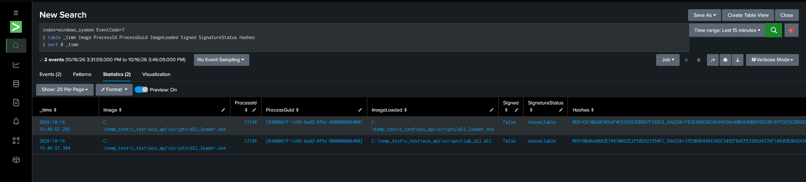
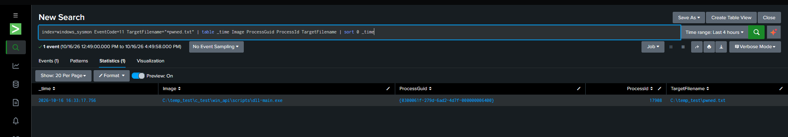
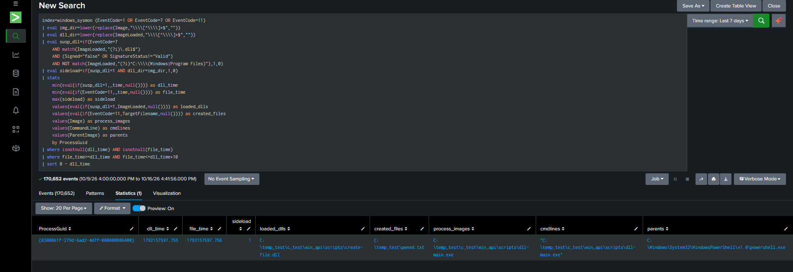

# Windows API Lab: DLL Loading, Sysmon Telemetry and File Creation Correlation

## 1. Purpose of the Lab

The purpose of this lab is to observe a DLL being dynamically loaded by a process on Windows and a file being created as a result of the DLL running, log these behaviors with Sysmon, and develop a detection in Splunk that correlates the two events.

The lab consists of the following stages:

1. Developing a DLL that creates a file from within `DllMain`.
2. Developing a Windows application that loads the DLL using `LoadLibraryA`.
3. Adding an Event ID 7 (Image loaded) monitoring rule to the Sysmon configuration and verifying the DLL load telemetry.
4. Enabling an Event ID 11 (File created) monitoring rule in the Sysmon configuration and verifying the file creation telemetry.
5. Correlating Event ID 7 and Event ID 11 records in Splunk using `ProcessGuid` and their temporal relationship.
6. Assessing the false positives from the initial correlation query and narrowing the query with behavioral conditions.

The goal throughout the lab is to generate end-to-end telemetry in a controlled lab scenario and turn that telemetry into detection logic.

## 2. Developing the Test DLL

In the first stage, a DLL named `create-file.dll` was created. The DLL's `DllMain` function checks for the `DLL_PROCESS_ATTACH` event, which occurs when the DLL is loaded into a process.

At this stage, the file `C:\temp_test\pwned.txt` is created and the text `DLL loaded successfully!` is written to it.

### 2.1. DLL source code

```c
#include <windows.h>
#include <stdio.h>

BOOL WINAPI DllMain(HINSTANCE hinstDLL, DWORD fdwReason,
                    LPVOID lpvReserved)
{
    if (fdwReason == DLL_PROCESS_ATTACH)
    {
        FILE *f = fopen("C:\\temp_test\\pwned.txt", "w");

        if (f != NULL)
        {
            fputs("DLL loaded successfully!\n", f);
            fclose(f);
        }
    }

    return TRUE;
}
```

### 2.2. How the code works

- `DllMain` is an entry point called by Windows for certain events, such as when a DLL is loaded or unloaded.
- `DLL_PROCESS_ATTACH` indicates that the DLL is being loaded into the relevant process.
- `fopen()` opens the target file in write mode; if the file does not exist, it creates it.
- `fputs()` writes the test message to the file.
- `fclose()` closes the file handle.

This code provides a controlled test scenario in which DLL loading can be associated with an observable file creation operation.

**Expected result:** When the DLL loads successfully, `C:\temp_test\pwned.txt` is created and the test message is written to it.

> Note: This is a lab example. Performing file I/O from within `DllMain` is not recommended in real applications; the loader lock can lead to unexpected behavior.

## 3. Developing the DLL Loader Application

A user-mode application named `dll-main.exe` was created to load the DLL. The application loads `create-file.dll` through the Windows API function `LoadLibraryA`.

### 3.1. Loader source code

```c
#include <windows.h>
#include <stdio.h>

int main(void)
{
    HMODULE hDll = LoadLibraryA("create-file.dll");

    if (hDll == NULL)
    {
        printf("LoadLibraryA failed: %lu\n", GetLastError());
        return 1;
    }

    printf("DLL loaded. Base address: %p\n", (void *)hDll);
    printf("File Created");

    FreeLibrary(hDll);
    printf("DLL unloaded.\n");

    return 0;
}
```

### 3.2. How the code works

- `LoadLibraryA()` is used to load the DLL into the current process.
- If the function fails, it returns `NULL`, and `GetLastError()` provides the error code.
- On a successful load, the `HMODULE` value represents the DLL's module handle and, in practice, the loaded module's base address.
- While the DLL is loading, the `DLL_PROCESS_ATTACH` code in `DllMain` runs and creates the test file.
- `FreeLibrary()` decrements the DLL's reference count; when the count reaches zero, the module can be unloaded.

This makes two separately observable behaviors occur within the same process: DLL loading and file creation.

## 4. Sysmon Configuration and Telemetry Collection

Running the code alone is not enough to develop a detection. These behaviors must appear in Windows event logs and be searchable in Splunk. For this reason, the Sysmon configuration was expanded in stages.

### 4.1. Stage one: Event ID 7 — Image loaded

First, an `ImageLoad` rule was added to the Sysmon configuration to monitor DLL loads from the lab directory.

The test artifacts were located in the following directory, so the configuration was adjusted to cover it:

`C:\temp_test\c_test\win_api\`

Event ID 7 provides telemetry about DLLs and other images loaded by a process. The following fields were examined in particular:

| Field | Meaning |
|---|---|
| `Image` | Path of the process that loaded the DLL |
| `ImageLoaded` | Path of the loaded DLL |
| `ProcessGuid` | Unique identifier of the process that generated the event |
| `Signed` | Signature information |
| `SignatureStatus` | Signature verification status |
| `Hashes` | Configured hash information |

At this stage, Event ID 7 records were queried in Splunk, confirming that `dll-main.exe` loaded `create-file.dll`.

The purpose of this step was to independently verify that DLL load telemetry was generated correctly and reached Splunk.



### 4.2. Stage two: Event ID 11 — File created

After verifying the DLL load telemetry, the `FileCreate` rule for monitoring file creation events was enabled in the Sysmon configuration.

Event ID 11 records events related to files created by a process. At this stage, the `TargetFilename` and `ProcessGuid` fields were examined in particular.

The following file was confirmed to have been created during the test:

`C:\temp_test\pwned.txt`

With Event ID 11, the file creation behavior resulting from the DLL running became observable in Splunk.



At this point, the two telemetry sources had been verified separately:

- **Event ID 7:** DLL load behavior.
- **Event ID 11:** File creation behavior.

Testing these two stages separately made it possible to identify which telemetry source was missing or incorrect before moving on to the correlation query.

## 5. Initial Correlation Attempt in Splunk

After verifying both event types, Event ID 7 and Event ID 11 records were joined within the context of the same process.

The basic correlation logic in the initial approach was:

1. Find a DLL load event.
2. Find a file creation event associated with the same `ProcessGuid`.
3. Check that the file was created after the DLL was loaded.

However, a DLL load and file creation by the same process within a short time window do not, by themselves, indicate suspicious behavior. Editors, browsers, installers, and other ordinary applications also routinely load DLLs and create files.

A large number of false positives (FPs) were observed in the initial, broad correlation query. This showed that joining the two event types based only on time and process association was not sufficient.

## 6. Narrowing the Detection Logic and Reducing False Positives

Additional conditions were added to the correlation query to reduce false positives.

### 6.1. DLL signature and path conditions

The `Signed` and `SignatureStatus` fields were used when evaluating DLL load events. The DLL path was also checked to exclude loads from under `C:\Windows` and `C:\Program Files`.

These conditions made it possible to operate on a narrower subset instead of treating every broadly captured DLL load event as a candidate for an alert.

### 6.2. Comparing the DLL and process directories

The directory of the loading process was extracted from the `Image` field, and the directory of the loaded DLL was extracted from `ImageLoaded`.

These two directories were compared to create an indicator named `sideload`. If the DLL and process were in the same directory and the DLL met the earlier suspicion conditions, a value of `sideload=1` was produced.

This value is not definitive proof of an actual DLL sideloading incident. Loading from the same directory is also common in legitimate applications. It was therefore treated only as a heuristic used together with the other conditions.

### 6.3. Ten-second correlation window

The correlation was limited to a 10-second window after the DLL load event.

This reduced matches with file operations that occurred over longer periods and might not have a meaningful relationship to the DLL load.

### 6.4. Adding process context

Event ID 1 (Process Create) was also included in the query. This allowed the process path, command line, and parent process information to be retained in the results.

This information makes it easier to analyze which application and launch context were associated with the matching behavior.

## 7. Final Splunk SPL Query

The following query represents the final correlation approach developed during the lab:

```spl
index=windows_sysmon (EventCode=1 OR EventCode=7 OR EventCode=11)
| eval img_dir=lower(replace(Image,"\\\\[^\\\\]+$",""))
| eval dll_dir=lower(replace(ImageLoaded,"\\\\[^\\\\]+$",""))
| eval susp_dll=if(EventCode=7
    AND match(ImageLoaded,"(?i)\.dll$")
    AND (Signed="false" OR SignatureStatus!="Valid")
    AND NOT match(ImageLoaded,"(?i)^C:\\\\(Windows|Program Files)"),1,0)
| eval sideload=if(susp_dll=1 AND dll_dir=img_dir,1,0)
| stats
    min(eval(if(susp_dll=1,_time,null()))) as dll_time
    min(eval(if(EventCode=11,_time,null()))) as file_time
    max(sideload) as sideload
    values(eval(if(susp_dll=1,ImageLoaded,null()))) as loaded_dlls
    values(eval(if(EventCode=11,TargetFilename,null()))) as created_files
    values(Image) as process_images
    values(CommandLine) as cmdlines
    values(ParentImage) as parents
    by ProcessGuid
| where isnotnull(dll_time) AND isnotnull(file_time)
| where file_time>=dll_time AND file_time<=dll_time+10
| sort 0 - dll_time
```

### Query workflow

1. Searches Event ID 1, 7, and 11 records.
2. Calculates the process and DLL directories.
3. Evaluates the DLL extension, signature status, and DLL path conditions in Event ID 7 records.
4. Calculates the `sideload` indicator for DLL loads classified as suspicious.
5. Groups events by `ProcessGuid`.
6. Extracts the DLL load and file creation times.
7. Requires the file creation to occur within 10 seconds after the DLL load.
8. Retains process, DLL, file, command line, and parent process information for analysis of the results.

## 8. Test Results

Running the final query against the lab data produced a single match.

| Field | Observed value |
|---|---|
| `ProcessGuid` | `{0300061f-279d-6ad2-4d7f-000000006400}` |
| Process | `C:\temp_test\c_test\win_api\scripts\dll-main.exe` |
| Loaded DLL | `C:\temp_test\c_test\win_api\scripts\create-file.dll` |
| Created file | `C:\temp_test\pwned.txt` |
| Parent process | `C:\Windows\System32\WindowsPowerShell\v1.0\powershell.exe` |
| DLL load time | `1792157597.755` |
| File creation time | `1792157597.756` |
| Time between the two events | Approximately 1 ms |
| `sideload` | `1` |
| Number of matches | 1 |



The result shows that the `dll-main.exe` process loaded `create-file.dll` and that, under the same `ProcessGuid`, the file `C:\temp_test\pwned.txt` was created approximately 1 millisecond later.

The many FPs seen in the initial broad correlation query were reduced to a single match in the narrowed query against the lab's current dataset.

This result **confirms that the test scenario was successfully validated in terms of telemetry and correlation**. By itself, it does not prove a low FP rate in a production environment or that every DLL sideloading incident can be detected.

## 9. Conclusion and Key Takeaways

This lab brought together Windows API usage, endpoint telemetry, and SIEM correlation.

- Dynamic loading of the DLL with `LoadLibraryA` was tested in practice.
- The file creation behavior performed at the DLL's `DllMain` entry point was observed.
- DLL load telemetry was enabled and verified with Sysmon Event ID 7.
- File creation telemetry was enabled and verified with Sysmon Event ID 11.
- Events were correlated in Splunk using `ProcessGuid` and their temporal relationship.
- The false positives produced by the initial approach were assessed.
- The query was narrowed with additional conditions, including the DLL path, signature information, directory comparison, and a time window.
- Process command line and parent process context were added to the results.

**Overall result:** The controlled DLL loading scenario was successfully observed end to end and verified with a Splunk correlation query using two different Sysmon event types.

## 10. Technical Limitations

- An unsigned DLL or a DLL with an invalid signature is not automatically malicious.
- The DLL and process being in the same directory is not, by itself, proof of sideloading.
- It cannot be stated with certainty that two events occurring in the same process within a short time window are causally related.
- Using `stats` with `values()` combines multiple process events into one row; care is needed when interpreting which event each field came from.
- Before use in a production environment, a baseline should be built from normal applications and tested against different benign and malicious scenarios.

These limitations do not invalidate the current lab result; they ensure that the claims supported by the detection rule are properly scoped.
