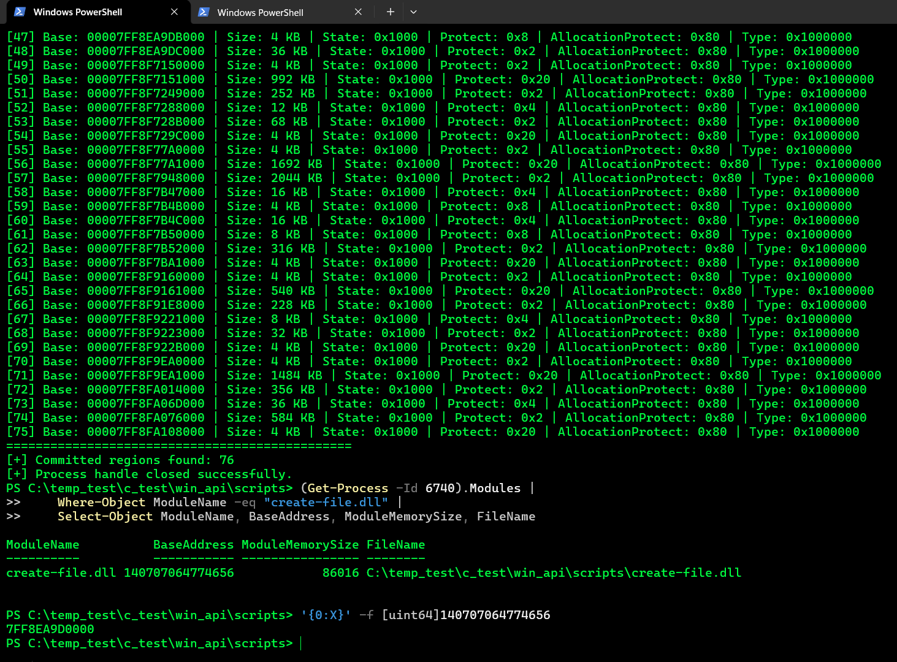
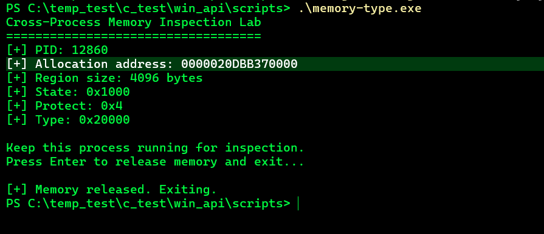
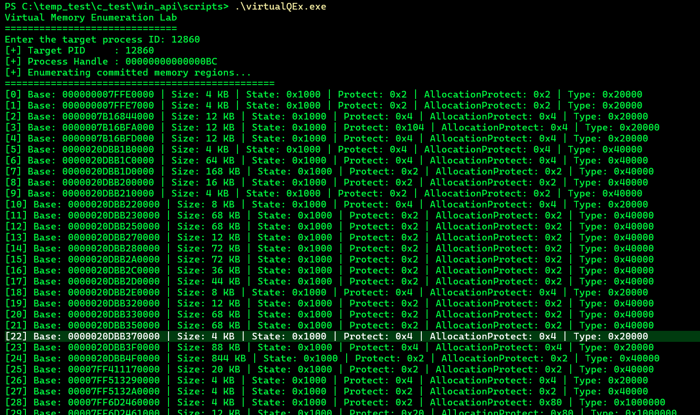
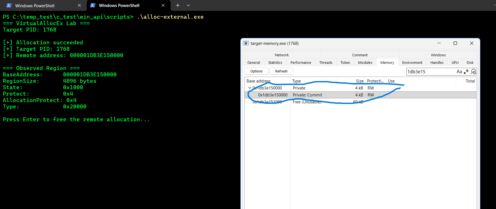

# Windows Virtual Memory Internals — Lab Report
## Phase 2: Memory Allocation & Cross-Process Inspection

**Platform:** Windows 11 x64  
**Language:** C  
**Compiler:** GCC (MinGW-w64)  
**APIs:** `VirtualQuery`, `VirtualQueryEx`, `VirtualAlloc`, `VirtualAllocEx`, `VirtualFree`, `VirtualFreeEx`, `OpenProcess`

## Lab Objective

The purpose of this lab is to understand the memory map of a Windows process; inspect the state, protection, and type information of memory regions; learn how one process can query another process's memory; and learn how memory can be allocated in another process's address space.

---

## Test 1 — Process Memory Enumeration

### Objective
List a process's virtual memory regions using `VirtualQueryEx()` and examine how DLLs appear in the memory map.

### APIs Used
- `OpenProcess()` — Obtain the required access rights for the target process.
- `VirtualQueryEx()` — Query the target process's virtual memory regions.

### Procedure
The program obtained a process handle using the target process's PID. It then traversed the virtual address space with `VirtualQueryEx()` and reported the starting addresses, sizes, states, protection attributes, and types of the memory regions.

Regions belonging to the `create-file.dll` module were also examined in the memory map.

### Observations
The DLL's base address was observed as `0x7FF8EA9D0000`. Different regions of the module had different page protections:

- `0x2` — `PAGE_READONLY`
- `0x4` — `PAGE_READWRITE`
- `0x20` — `PAGE_EXECUTE_READ`
- `0x1000000` — `MEM_IMAGE`

It is normal for memory regions within the same DLL to have different protections. The code, data, and read-only sections of a PE file can be mapped with different protection attributes.

### Result
A process's virtual address space is not a single uniform block of memory. It consists of many regions with different states, protections, and types.

These regions can be examined programmatically using `VirtualQueryEx()`.

---

## Test 2 — VirtualAlloc and MEM_PRIVATE

### Objective
Allocate private memory within a process and examine how that memory can be queried by another process.

### APIs Used
- `VirtualAlloc()` — Allocate memory in the current process's address space.
- `VirtualQuery()` — Query the properties of the allocated region.
- `VirtualQueryEx()` — Query another process's memory map.
- `VirtualFree()` — Release the allocated memory.

### Procedure
The test program allocated a 4096-byte memory region using `VirtualAlloc()`. Harmless text was written to the region, and it was queried with `VirtualQuery()`.

### Observations

| Field | Observed value |
|---|---|
| Process PID | `12860` |
| Memory address | `0x20DBB370000` |
| Region size | 4096 bytes |
| State | `0x1000` — `MEM_COMMIT` |
| Protect | `0x4` — `PAGE_READWRITE` |
| Type | `0x20000` — `MEM_PRIVATE` |

This result shows that the memory was allocated as a private virtual memory region within the current process.

### Result and Verification Note
The purpose of this test was to understand how memory allocated in our own process can be observed by another process using `VirtualQueryEx()`.

---

## Test 3 — Cross-Process Memory Allocation with VirtualAllocEx

### Objective
Have one process allocate memory in another process's virtual address space and verify the resulting region with `VirtualQueryEx()`.

### APIs Used
- `OpenProcess()` — Open the target process with the required access rights.
- `VirtualAllocEx()` — Allocate memory in the target process's address space.
- `VirtualQueryEx()` — Query the properties of the memory region in the target process.
- `VirtualFreeEx()` — Release the memory allocated in the target process.

[Source Code](../../scripts/alloc-external.c)

### Procedure
Two separate programs were used:

**Target process:** Remained running and reported its PID.

**Allocator process:** Received the target's PID, obtained the required handle with `OpenProcess()`, and allocated 4096 bytes in the target's address space using `VirtualAllocEx()`.

The same address was then queried with `VirtualQueryEx()`.

### Observations

| Field | Observed value |
|---|---|
| Target PID | `1768` |
| Remote address | `0x1db3e150000` |
| RegionSize | 4096 bytes |
| State | `0x1000` — `MEM_COMMIT` |
| Protect | `0x4` — `PAGE_READWRITE` |
| AllocationProtect | `0x4` — `PAGE_READWRITE` |
| Type | `0x20000` — `MEM_PRIVATE` |

`VirtualAllocEx()` succeeded, and the returned address appeared as the start address of the same region in the `VirtualQueryEx()` query.

### Result
Unlike the first two tests, this test showed that memory was allocated directly in the target process's address space.

The process that calls `VirtualAllocEx()` and the process in which the memory is allocated are different. When the required access rights are available, the allocation takes place in the target process's virtual address space.

Allocating memory alone does not constitute code injection. No code was executed in the target, and no DLL was injected in this test.

---

## Overall Assessment

The three stages covered the following concepts:

1. **Memory enumeration:** Inspecting a process's virtual memory map.
2. **Private memory allocation:** Allocating private memory within the current process using `VirtualAlloc()`.
3. **Cross-process allocation:** Allocating memory in another process's address space using `VirtualAllocEx()` and verifying it with `VirtualQueryEx()`.

These exercises form the foundation for understanding Windows virtual memory management and inter-process memory interactions. Later stages can examine changing page protections, the behavior of `VirtualProtect()` and `VirtualProtectEx()`, and how these behaviors can be evaluated for defensive telemetry.

**Security scope:** All experiments were performed on controlled test processes. The goal is to understand Windows memory management and its observability.
