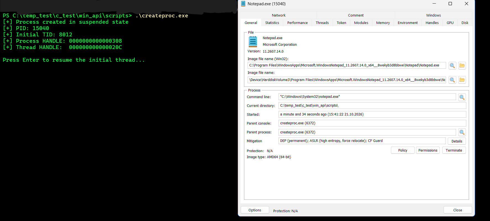
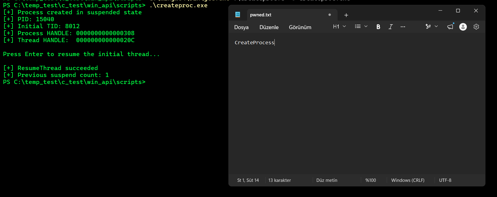
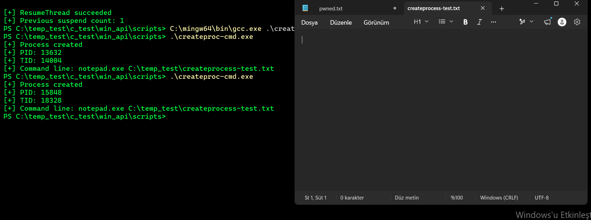

# CreateProcessA — Process Creation Lab

## Objective

The purpose of this lab is to examine in practice how the `CreateProcessA()` API creates a new Windows process and its initial thread.

The lab covers:

- Creating a process normally.
- Inspecting the returned PID and TID values.
- Observing the process and initial thread handles.
- Creating a process with its initial thread suspended by using `CREATE_SUSPENDED`.
- Resuming the initial thread with `ResumeThread()`.
- Observing suspend count behavior.

---

# Test 1 — Normal Process Creation

## Code

[CreateProcessA Source Code](../../scripts/createproc.c)

## Result

When the program was run, it produced the following output:

```text
Process created!
PID: 3196
TID: 14900
```

As a result of the `CreateProcessA()` call, a new `notepad.exe` process and its initial thread were created.

---

# PROCESS_INFORMATION

`CreateProcessA()` does more than start a new process. It also returns information about the created process and its initial thread.

The basic structure is:

```c
typedef struct _PROCESS_INFORMATION {
    HANDLE hProcess;
    HANDLE hThread;
    DWORD  dwProcessId;
    DWORD  dwThreadId;
} PROCESS_INFORMATION;
```

The fields mean:

### `hProcess`

A handle to the newly created process.

This handle can later be used to perform permitted operations on the process.

### `hThread`

A handle to the new process's initial thread.

This handle can be used with thread APIs such as `ResumeThread()` on the initial thread.

### `dwProcessId`

The PID of the newly created process.

### `dwThreadId`

The TID of the initial thread.

The basic process creation flow can therefore be represented as:

```text
CreateProcessA()
       |
       +---- Process
       |       |
       |       +---- HANDLE
       |       +---- PID
       |
       +---- Initial Thread
               |
               +---- HANDLE
               +---- TID
```

---

# Test 2 — CREATE_SUSPENDED

In the second experiment, the `dwCreationFlags` parameter of the `CreateProcessA()` call was changed.

Instead of the normal value:

```c
0
```

the following flag was used:

```c
CREATE_SUSPENDED
```

The goal was to create the process while preventing its initial thread from immediately beginning normal execution.

## Code

[CreateProcess CREATE_SUSPENDED Source Code](../../scripts/createproc-suspend.c)

---

# Observed Result

During the test, the following output was produced:

```text
[+] Process created in suspended state
[+] PID: 15040
[+] Initial TID: 8012
[+] Process HANDLE: 0000000000000308
[+] Thread HANDLE:  000000000000020C

Press Enter to resume the initial thread...
```

At this point, the process had been created, but its initial thread was suspended.



After the `ResumeThread()` call, the following result was observed:

```text
[+] ResumeThread succeeded
[+] Previous suspend count: 1
```



---

# Suspend Count

When `ResumeThread()` succeeds, it returns the thread's previous suspend count.

The lab produced:

```text
Previous suspend count: 1
```

In simplified terms, the sequence was:

```text
Initial Thread
     |
     | Suspend Count = 1
     |
ResumeThread()
     |
     v
Suspend Count = 0
     |
     v
Thread execution can continue
```

`ResumeThread()` should not be thought of simply as “run the thread.” The API decrements the suspend count. When the count reaches zero, the thread is no longer suspended and can be scheduled to run.

---

# Why Is CREATE_SUSPENDED Important?

`CREATE_SUSPENDED` creates a new process without allowing its initial thread to immediately begin normal execution.

Legitimate software can use this behavior for purposes such as debugging, process initialization, and process management.

The same primitive is also relevant to understanding behaviors such as process hollowing in security research.

Therefore, `CREATE_SUSPENDED` alone is not an indicator of malicious activity. The APIs and behaviors involved afterward must also be considered.

---

# API / Mechanism Summary

| API / Structure | Purpose |
|---|---|
| `CreateProcessA()` | Creates a new process and its initial thread |
| `STARTUPINFOA` | Defines startup properties for the new process |
| `PROCESS_INFORMATION` | Returns process/thread handles and IDs |
| `CREATE_SUSPENDED` | Creates the initial thread in a suspended state |
| `ResumeThread()` | Decrements the thread's suspend count |
| `CloseHandle()` | Closes process/thread handles |

---

# Conclusion

This lab showed that a `CreateProcessA()` call involves more than simply running an executable.

The following relationship was observed as a result of the API call:

```text
CreateProcessA()
       |
       +---- Process Object
       |       +---- PID
       |       +---- HANDLE
       |
       +---- Initial Thread
               +---- TID
               +---- HANDLE
```

It was also confirmed that `CREATE_SUSPENDED` can be used to control the initial thread's execution during process creation, and that `ResumeThread()` can change the suspend count from `1 → 0`.

---

# Test 3 — lpCommandLine & Sysmon EID 1 Correlation

## Objective

This test examines the difference between the `lpApplicationName` and `lpCommandLine` parameters of the `CreateProcessA()` function.

The created process's Sysmon Event ID 1 telemetry was also inspected to connect process creation at the API level with detection telemetry.

---

## Code

[lpCommandLine Source Code](../../scripts/createproc-cmd.exe)

When the program was run, it produced the following result:

```text
[+] Process created
[+] PID: 15848
[+] TID: 18328
[+] Command line: notepad.exe C:\temp_test\createprocess-test.txt
```



The Notepad process was created, and `createprocess-test.txt` was passed to Notepad as a command-line argument.

`CreateProcessA()` does not open the TXT file. The API creates the Notepad process; the newly created Notepad process processes its own command line and opens the specified file.

---

## lpApplicationName vs lpCommandLine

The test used two different parameters:

```c
lpApplicationName =
"C:\\Windows\\System32\\notepad.exe"
```

This parameter tells Windows which executable to run.

```c
lpCommandLine =
"notepad.exe C:\\temp_test\\createprocess-test.txt"
```

This specifies the command line passed to the created process.

In simplified terms:

```text
lpApplicationName
        |
        v
Which executable?
        |
        v
notepad.exe


lpCommandLine
        |
        v
Which command line?
        |
        v
notepad.exe C:\temp_test\createprocess-test.txt
```

In accordance with the `CreateProcessA()` documentation, the command line was stored in a modifiable `char` buffer:

```c
char cmdLine[] = "...";
```

---

# Sysmon EID 1 Correlation

The process creation event was examined in Sysmon using the following SPL query:

```spl
index=windows_sysmon EventCode=1 ProcessId=15848
| table _time Image CommandLine ParentImage ParentProcessId ProcessId
```

The observed telemetry was:

```text
Time:
2026-10-21 16:07:29.565

Image:
C:\Program Files\WindowsApps\
Microsoft.WindowsNotepad_11.2607.14.0_x64__8wekyb3d8bbwe\
Notepad\Notepad.exe

CommandLine:
notepad.exe C:\temp_test\createprocess-test.txt

ParentImage:
C:\temp_test\c_test\win_api\scripts\createproc-cmd.exe

ParentProcessId:
19696

ProcessId:
15848
```

---

## API → Telemetry Correlation

The Sysmon telemetry confirmed the process creation performed during the lab.

| API / Lab | Sysmon EID 1 |
|---|---|
| Created process | `ProcessId=15848` |
| Executed image | `Image=...\Notepad.exe` |
| `lpCommandLine` | `CommandLine=notepad.exe C:\temp_test\createprocess-test.txt` |
| API caller | `ParentImage=...\createproc-cmd.exe` |
| Caller PID | `ParentProcessId=19696` |

The process relationship was therefore observed as:

```text
createproc-cmd.exe
PID 19696
        |
        | CreateProcessA()
        v
     Notepad.exe
     PID 15848
        |
        +-- CommandLine
            notepad.exe
            C:\temp_test\createprocess-test.txt
```

Sysmon EID 1 made this relationship visible through the `ParentImage`, `ParentProcessId`, `Image`, `ProcessId`, and `CommandLine` fields.

---

## Image Path Observation

Although the following path was used in the code:

```text
C:\Windows\System32\notepad.exe
```

Sysmon telemetry showed the running image as:

```text
C:\Program Files\WindowsApps\
Microsoft.WindowsNotepad_...\Notepad\Notepad.exe
```

Because the modern Windows 11 Notepad app is packaged and/or redirected, the executable path supplied to the API may differ from the final image path observed in telemetry.

This matters for detection:

> Do not assume that the requested executable path during process creation will always exactly match the image path reported in telemetry.

---

# Detection Engineering Connection

This test practically confirmed the following chain:

```text
C Program
   |
   | CreateProcessA()
   |
   +-- lpApplicationName
   |
   +-- lpCommandLine
   |
   v
Windows Process Creation
   |
   +-- Process
   +-- Initial Thread
   |
   v
Sysmon EID 1
   |
   +-- Image
   +-- CommandLine
   +-- ProcessId
   +-- ParentImage
   +-- ParentProcessId
```

This directly demonstrated how a process creation performed through `CreateProcessA()` appears in Sysmon.
